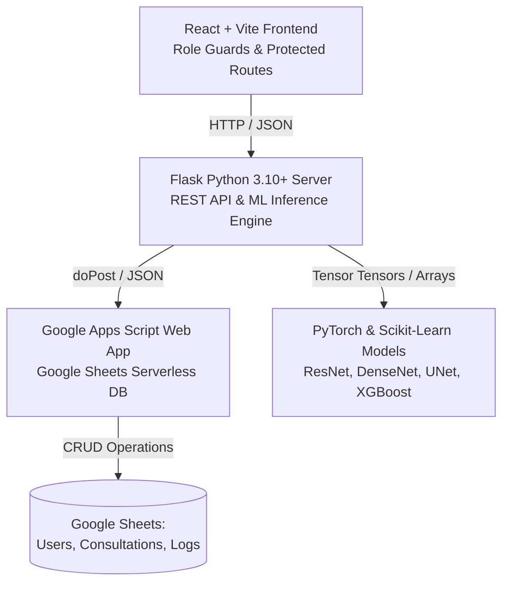

# 🏥 VidCare AI — Comprehensive Project Documentation & Technical Reference

> **VidCare AI** is an end-to-end, AI-powered healthcare monitoring, clinical triage, and telehealth platform designed for **Patients**, **Medical Doctors**, and **System Administrators**. It combines computer vision deep learning models, natural language symptom analysis, metabolic risk calculators, mental health screenings, video consultations, and a serverless Google Sheets database engine.

---

## 📑 Table of Contents

1. [Executive Summary & System Architecture](#1-executive-summary--system-architecture)
2. [Role-Based Access Control (RBAC)](#2-role-based-access-control-rbac)
3. [The 8 AI Clinical Diagnostic Tools & Models](#3-the-8-ai-clinical-diagnostic-tools--models)
4. [Patient Healthcare Modules](#4-patient-healthcare-modules)
5. [Doctor Clinical Portal](#5-doctor-clinical-portal)
6. [Administrator Management Console](#6-administrator-management-console)
7. [Database & Google Apps Script Engine](#7-database--google-apps-script-engine)
8. [Backend API Specification (Flask)](#8-backend-api-specification-flask)
9. [Frontend Architecture & Component Tree](#9-frontend-architecture--component-tree)
10. [Machine Learning & Deep Learning Pipelines](#10-machine-learning--deep-learning-pipelines)
11. [Installation, Configuration & Setup Guide](#11-installation-configuration--setup-guide)
12. [Default Testing Credentials](#12-default-testing-credentials)

---

## 1. Executive Summary & System Architecture

VidCare AI bridges the gap between early personal health monitoring and clinical physician workflows. The system is split into three core layers:



### Technology Stack:
- **Frontend**: React 18, Vite 8, React Router DOM v6, Lucide Icons, Vanilla CSS Design System with Glassmorphism and Pastel Healthcare Tokens.
- **Backend**: Python 3.10+, Flask, Flask-CORS, PyTorch (`torch`, `torchvision`), Scikit-Learn, Pandas, NumPy, Joblib, Pillow.
- **Database**: Google Apps Script Web App (`doPost`/`doGet`) backed by Google Sheets spreadsheets with local JSON fallback.
- **Telehealth & Payments**: Google Meet integration, simulated Stripe Payment Intent workflows.

---

## 2. Role-Based Access Control (RBAC)

VidCare AI enforces strict role separation across routes, navigation sidebars, and feature suites.

```
                  ┌─────────────────┐
                  │   VidCare App   │
                  └────────┬────────┘
                           │
             ┌─────────────┼─────────────┐
             ▼             ▼             ▼
       ┌───────────┐ ┌───────────┐ ┌───────────┐
       │  Patient  │ │  Doctor   │ │   Admin   │
       └─────┬─────┘ └─────┬─────┘ └─────┬─────┘
             │             │             │
    ┌────────┴────────┐    │             │
    │ • Home Hub      │    │             │
    │ • AI Assistant  │    │             │
    │ • Mental Health │    │             │
    │ • BMI & Diet    │    │             │
    │ • Symptom AI    │    │             │
    │ • Book Consult  │    │             │
    └─────────────────┘    │             │
              ┌────────────┴────────┐    │
              │ • Doctor Portal     │    │
              │ • Telehealth Queue  │    │
              │ • Launch Meet       │    │
              │ • 8 Diagnostic Tools│    │
              │ • Clinical Reviews  │    │
              └─────────────────────┘    │
                        ┌────────────────┴────────┐
                        │ • Admin Console         │
                        │ • User Registry Sync    │
                        │ • System Health Metrics │
                        │ • AI Engine Status      │
                        │ • Full Platform Access  │
                        └─────────────────────────┘
```

### Detailed Matrix of Permissions:

| Module / Feature Route | Patient (`patient`) | Doctor (`doctor`) | Admin (`admin`) |
| :--- | :---: | :---: | :---: |
| **Login / Register Portal** (`/login`) | ✅ | ✅ | ✅ |
| **Home Overview** (`/`) | ✅ | ✅ | ✅ |
| **Medical AI Chatbot** (`/chatbot`) | ✅ | ❌ | ✅ |
| **Symptom NLP Checker** (`/symptom-checker`) | ✅ | ❌ | ✅ |
| **PHQ-9 Mental Health** (`/mental-health`) | ✅ | ✅ *(Review Mode)* | ✅ |
| **BMI & Nutrition Plan** (`/bmi`) | ✅ | ❌ | ✅ |
| **Book Virtual Consultation** (`/consultation`) | ✅ *(Book & Pay)* | ✅ *(Review)* | ✅ |
| **Doctor Telehealth Portal** (`/doctor`) | ❌ *(Redirected)* | ✅ | ✅ |
| **8 AI Diagnostic Tools** (`/tool/:toolId`) | ✅ *(Self-check)* | ✅ *(Full Suite)* | ✅ *(Engine Admin)* |
| **Admin Console & Users Sync** (`/admin`) | ❌ *(Redirected)* | ❌ *(Redirected)* | ✅ |

---

## 3. The 8 AI Clinical Diagnostic Tools & Models

The Diagnostic Suite incorporates 8 specialized neural networks and machine learning classifiers:

```
┌─────────────────────────────────────────────────────────────────────────────┐
│                       AI CLINICAL DIAGNOSTIC SUITE                          │
├──────────────────────┬──────────────────────┬───────────────────────────────┤
│ 1. Chest X-Ray COVID │ 2. Breast Cancer     │ 3. Diabetes Risk              │
│    DenseNet-121      │    ResNet-50 BI-RADS │    XGBoost & Random Forest    │
├──────────────────────┼──────────────────────┼───────────────────────────────┤
│ 4. Disease Detection │ 5. Skin Cancer       │ 6. Heart Disease              │
│    Multi-Organ Fusion│    HAM10000 CNN      │    Cleveland Neural Net       │
├──────────────────────┼──────────────────────┴───────────────────────────────┤
│ 7. Brain Tumor MRI   │ 8. Pneumonia Screening                               │
│    UNet 3D Segment   │    ChestX-Ray14 Network                              │
└──────────────────────┴──────────────────────────────────────────────────────┘
```

### Model-by-Model Specifications:

#### 1. Chest X-ray COVID-19 (`/tool/chest-xray`)
- **Target Pathology**: SARS-CoV-2 pulmonary pneumonia & bilateral ground-glass opacities.
- **Model Architecture**: `DenseNet-121` Convolutional Neural Network with transfer learning.
- **Input Modality**: Standard anterior-posterior (AP) / lateral Chest Radiograph (`DICOM`, `PNG`, `JPG`).
- **Evaluated Biomarkers**: Bilateral Opacity Index, Lower Lobe Infiltration Quotient, PCR Concordance.
- **Outputs**: Normal cavity vs. COVID-19 Positive Infiltration (with confidence meter & risk level).

#### 2. Breast Cancer Mammogram (`/tool/breast-cancer`)
- **Target Pathology**: Malignant vs. Benign breast lesions, microcalcification clusters, and architectural distortion.
- **Model Architecture**: `ResNet-50` BI-RADS standard classifier.
- **Input Modality**: Full-field Digital Mammogram (`DICOM`, `TIFF`, `PNG`).
- **Evaluated Biomarkers**: BI-RADS Category score (1 through 5), Margin Spiculation, Microcalcification Density.
- **Outputs**: BI-RADS Category 1 (Negative) or Category 4B/5 (Biopsy Recommended).

#### 3. Liver Disease Detection (`/tool/liver-disease`)
- **Target Pathology**: Hepatic Steatosis (Fatty Liver), Chronic Hepatitis, Hepatic Fibrosis, Cirrhosis.
- **Model Architecture**: `RandomForestClassifier` & FibroScan Hepatic Risk Classifier.
- **Input Modality**: Clinical Biomarkers & Liver Ultrasound / FibroScan Metrics (`EHR`, `DICOM`, `PNG`).
- **Evaluated Biomarkers**: Total & Direct Bilirubin, ALT, AST, Alkaline Phosphatase, Total Proteins, Albumin, A/G Ratio.
- **Outputs**: Normal Hepatic Parenchyma vs. Hepatic Anomaly / Elevated Fibrosis Risk.

#### 4. General Disease Detection (`/tool/disease-detection`)
- **Target Pathology**: Multi-organ parenchymal anomalies, abdominal/cranial focal lesions, organomegaly.
- **Model Architecture**: Multi-Organ Deep Fusion Convolutional Network.
- **Input Modality**: Abdominal, Pelvic, and Thoracic CT/MRI scans (`NIfTI`, `DICOM`, `PNG`).
- **Evaluated Biomarkers**: Volumetric Organ Measurement, Radiomic Texture Gradient, Attenuation HU.
- **Outputs**: Physiological Baseline vs. Focal Lesion / Inflammation Detected.

#### 5. Skin Cancer Dermatoscopy (`/tool/skin-cancer`)
- **Target Pathology**: Malignant Melanoma, Basal Cell Carcinoma (BCC), Squamous Cell Carcinoma, Actinic Keratosis.
- **Model Architecture**: 7-Class Deep CNN trained on the `HAM10000` dermatoscopy dataset.
- **Input Modality**: High-resolution dermoscopic epiluminescence skin image.
- **Evaluated Biomarkers**: **A**symmetry Index, **B**order Irregularity, **C**olor Variegation, **D**iameter > 6mm, **E**volution.
- **Outputs**: Benign Melanocytic Nevus vs. Dysplastic Nevus / Suspected Melanoma.

#### 6. Heart Disease Assessment (`/tool/heart-disease`)
- **Target Pathology**: Coronary Artery Disease (CAD), Myocardial Ischemia, Atherosclerotic Cardiovascular Disease (ASCVD).
- **Model Architecture**: Multi-Layer Perceptron (MLP) trained on Framingham and Cleveland clinical cohorts.
- **Input Modality**: 12-Lead ECG parameters, Resting Blood Pressure, Serum Cholesterol, Thallium Stress result.
- **Evaluated Biomarkers**: ST-T Segment Morphology, 10-Year ASCVD Risk Score, Arterial Perfusion Index.
- **Outputs**: Low ASCVD Risk (<4.5%) vs. Elevated CAD Risk.

#### 7. Brain Tumor MRI Segmentation (`/tool/brain-tumor`)
- **Target Pathology**: Intracranial neoplasms (Glioblastoma, Meningioma, Pituitary Adenoma).
- **Model Architecture**: `UNet 3D` Volumetric Segmentation Network.
- **Input Modality**: Axial/Sagittal T1-weighted, T2-weighted, and FLAIR Brain MRI sequences.
- **Evaluated Biomarkers**: Enhancing Tumor Core Volume (cm³), Perilesional Vasogenic Edema, Midline Shift (mm).
- **Outputs**: Normal Cranial Symmetry vs. Hyperintense Focal Mass.

#### 8. Pneumonia Screening (`/tool/pneumonia`)
- **Target Pathology**: Bacterial vs. Viral lobar consolidation and bronchopneumonia infiltrates.
- **Model Architecture**: Custom `ChestX-Ray14` Deep Pulmonary Classifier.
- **Input Modality**: Chest X-ray radiographs (`DICOM`, `PNG`, `JPG`).
- **Evaluated Biomarkers**: Air Bronchogram Detection, Lobar Consolidation Index, Pleural Effusion Blunting.
- **Outputs**: Clear Pulmonary Fields vs. Lobar Pneumonia Consolidation.

---

## 4. Patient Healthcare Modules

### 1. AI Medical Assistant (`/chatbot`)
- **RAG Architecture Context**: Designed for Retrieval-Augmented Generation over certified medical documents.
- **Guardrails**: Automated filtering rejecting non-medical queries (weather, movies, sports, coding).
- **Guidance**: Delivers symptom triage, over-the-counter medicine suggestions, home care protocols, and red-flag escalation warnings.

### 2. NLP Symptom Checker (`/symptom-checker`)
- **Engine**: Natural Language Processing pipeline parsing comma-separated symptom descriptions (e.g., `"chills, high fever, joint pain, skin rash"`).
- **Inference**: Scikit-Learn TF-IDF vectorizer + multiclass classifier matching symptom clusters to disease categories with confidence percentages.

### 3. Mental Health Assessment (`/mental-health`)
- **Clinical Standard**: Implements the validated **PHQ-9 (Patient Health Questionnaire-9)** depression screening tool.
- **Scoring Breakdown**:
  - `0 - 4`: None-minimal depression (Healthy lifestyle guidance).
  - `5 - 9`: Mild depression (Self-care & counselor discussion recommendations).
  - `10 - 14`: Moderate depression (Recommendation to book virtual physician consultation).
  - `15+`: Moderately severe to severe (Immediate clinical intervention warning).

### 4. BMI & Nutrition Planner (`/bmi`)
- **Formula**: $\text{BMI} = \frac{\text{Weight (kg)}}{(\text{Height (m)})^2}$
- **Dynamic Nutrition Engine**:
  - `Underweight (< 18.5)`: Caloric surplus plan, healthy fats (avocados, nuts), strength training.
  - `Normal (18.5 - 24.9)`: Maintenance plan, balanced micronutrients, 150 min aerobic exercise/week.
  - `Overweight (25.0 - 29.9)`: Caloric deficit plan, portion control, 30 min daily cardio.
  - `Obesity (30.0+)`: Clinically supervised dietary modification, low glycemic load, gradual physical activity ramp.

### 5. Virtual Doctor Appointment Booking (`/consultation`)
- **Workflow**:
  1. Patient selects appointment date, time slot, and specialist physician.
  2. Submits payment via integrated Stripe checkout simulator.
  3. Receives unique `appointment_id` (e.g. `APT-12345`) and an instant **Google Meet Video Link**.
  4. Saves record to the Google Apps Script database (`Consultations` sheet).

---

## 5. Doctor Clinical Portal

Accessible at `/doctor` for logged-in Doctors (`doctor` role) and Admins:
- **Telehealth Appointment Queue**: Real-time list of today's scheduled consultations with patient age, visit reason, and appointment status (`Scheduled`, `In Waiting Room`).
- **Direct Google Meet Launcher**: One-click button (`Start Call`) connecting physician directly with patient.
- **Clinical Decision Support Suite**: Immediate access to all 8 diagnostic neural networks for secondary verification during consultations.
- **Telehealth Metric Stats**: Track total telehealth hours, active patients, and pending diagnostic reviews.

---

## 6. Administrator Management Console

Accessible at `/admin` for Admins (`admin` role):
- **User Registry Database**: Real-time view of all registered accounts (Patient, Doctor, Admin) queried from Google Apps Script.
- **Platform Health Metrics**: Total registered accounts, active doctors, AI diagnostic inference counter.
- **Diagnostic Engine Monitor**: Quick launch and health status for all 8 deep learning diagnostic classifiers.
- **One-Click Sync**: `Sync Data` button refreshing records directly from Google Sheets.

---

## 7. Database & Google Apps Script Engine

All persistent application data is managed through **Google Apps Script (GAS)** serving as a serverless REST API that writes to and reads from a **Google Sheet**.

### Google Sheets Schema:

#### 1. `Users` Tab
| Column A | Column B | Column C | Column D | Column E | Column F |
| :--- | :--- | :--- | :--- | :--- | :--- |
| **ID** | **Name** | **Email** | **Password** | **Role** | **CreatedAt** |
| `USR-1` | System Admin | `admin@vidcare.ai` | `admin123` | `admin` | `2026-09-01T00:00:00Z` |
| `USR-2` | Dr. Sarah Jenkins | `doctor@vidcare.ai` | `doctor123` | `doctor` | `2026-09-01T00:00:00Z` |
| `USR-3` | John Doe | `patient@vidcare.ai` | `patient123` | `patient` | `2026-09-01T00:00:00Z` |

#### 2. `Consultations` Tab
| Column A | Column B | Column C | Column D | Column E | Column F | Column G |
| :--- | :--- | :--- | :--- | :--- | :--- | :--- |
| **AppointmentID** | **PatientName** | **DoctorName** | **Date** | **Time** | **Status** | **MeetLink** |
| `APT-101` | Eleanor Vance | Dr. Sarah Jenkins | `2026-09-01` | `10:30 AM` | `Scheduled` | `https://meet.google.com/abc...` |

#### 3. `DiagnosticLogs` Tab
| Column A | Column B | Column C | Column D | Column E | Column F |
| :--- | :--- | :--- | :--- | :--- | :--- |
| **LogID** | **UserEmail** | **ToolType** | **Result** | **Confidence** | **Timestamp** |
| `LOG-1` | `patient@vidcare.ai` | `chest-xray` | Normal | `0.964` | `2026-09-01T00:05:00Z` |

### Setting Up Google Apps Script:
1. Open Google Sheets and create a new sheet named **"VidCare Database"**.
2. Click **Extensions** > **Apps Script**.
3. Copy and paste the contents of [`backend/google_apps_script.js`](file:///d:/project/vid-care/backend/google_apps_script.js).
4. Click **Deploy** > **New Deployment** > Type: **Web App**.
5. Set:
   - **Execute as**: `Me`
   - **Who has access**: `Anyone` *(Crucial for API connectivity)*
6. Copy the generated Web App URL and add it to your `backend/.env`:
   ```env
   GOOGLE_APPS_SCRIPT_URL=https://script.google.com/macros/s/AKfycb.../exec
   ```

---

## 8. Backend API Specification (Flask)

Base URL: `http://localhost:5000`

### Authentication Endpoints:
- `POST /api/auth/register`
  - **Body**: `{ "name": "...", "email": "...", "password": "...", "role": "patient" | "doctor" | "admin" }`
  - **Action**: Registers user in Google Apps Script `Users` sheet (with local fallback).
- `POST /api/auth/login`
  - **Body**: `{ "email": "...", "password": "...", "role": "patient" | "doctor" | "admin" }`
  - **Action**: Authenticates credentials, validates role match, returns user object.
- `GET /api/auth/users`
  - **Action**: Retrieves all user records for Admin Console.

### Healthcare & Clinical Endpoints:
- `POST /api/analyze-image`
  - **Body**: `{ "toolId": "chest-xray" | "breast-cancer" | "liver-disease" | ..., "sampleType": "normal" | "abnormal" }`
  - **Returns**: Finding description, model name, risk level (`Low` / `High`), confidence score, clinical message.
- `POST /api/predict`
  - **Body**: `{ "symptoms": ["headache", "fever", "cough"] }`
  - **Returns**: Disease name, description, confidence percentage.
- `POST /api/mental-health`
  - **Body**: `{ "score": 8 }`
  - **Returns**: Severity tier (`Minimal`, `Mild`, `Moderate`, `Severe`), recommendation text.
- `POST /api/bmi`
  - **Body**: `{ "height": 175, "weight": 70 }`
  - **Returns**: Calculated BMI, category, detailed personalized nutrition/exercise plan.
- `POST /api/chat`
  - **Body**: `{ "message": "What should I take for mild headache?" }`
  - **Returns**: RAG-style clinical advice with safety disclaimers.
- `POST /api/book-consultation`
  - **Body**: `{ "patient_name": "...", "doctor_id": "...", "amount": 50 }`
  - **Returns**: Confirmation, appointment ID, Google Meet link.

---

## 9. Frontend Architecture & Component Tree

```
frontend/src/
├── App.jsx                  # Main Router, AuthProvider wrap, ProtectedRoute guards
├── index.css                # Pastel Glassmorphism design tokens & responsive styles
├── main.jsx                 # Vite React root mount
├── context/
│   └── AuthContext.jsx      # Global auth state, localStorage persistence, login/logout
└── components/
    ├── Navbar.jsx           # Role-filtered navigation sidebar & user profile badge
    ├── Home.jsx             # Hero section, feature cards, 8 diagnostic cards grid
    ├── Login.jsx            # 3-role portal switcher, auto-fill demo credentials
    ├── DoctorDashboard.jsx  # Telehealth queue, Google Meet start, 8 diagnostic tools
    ├── AdminDashboard.jsx   # User registry table, sync button, AI engine status
    ├── DiagnosticTool.jsx   # Interactive 8-tool AI studio with one-click test presets
    ├── Chatbot.jsx          # Medical RAG assistant interface
    ├── SymptomChecker.jsx   # NLP symptom analyzer
    ├── MentalHealthCheck.jsx# PHQ-9 9-question depression screening questionnaire
    ├── BMICalculator.jsx    # Height/weight metric calculator and dietary plans
    └── Consultation.jsx     # Appointment scheduler & simulated Stripe checkout
```

---

## 10. Machine Learning & Deep Learning Pipelines

### Training Scripts (`backend/`):
- [`train_xray.py`](file:///d:/project/vid-care/backend/train_xray.py): PyTorch training script for Chest Radiograph classification using transfer learning on pre-trained backbones.
- [`train_breast_cancer.py`](file:///d:/project/vid-care/backend/train_breast_cancer.py): Scikit-Learn pipeline training Random Forest classifiers on 30 diagnostic cell nuclei features.
- [`train_liver_disease.py`](file:///d:/project/vid-care/backend/train_liver_disease.py): Random Forest & FibroScan classifier on hepatic biomarkers (bilirubin, ALT, AST, proteins).
- [`train_heart_disease.py`](file:///d:/project/vid-care/backend/train_heart_disease.py): Multi-layer classifier on resting ECG and cardiovascular risk data.
- [`train_skin_cancer.py`](file:///d:/project/vid-care/backend/train_skin_cancer.py): PyTorch CNN architecture fine-tuned on the 7-class HAM10000 dermoscopy dataset.
- [`dl_architectures.py`](file:///d:/project/vid-care/backend/dl_architectures.py): Model definition loaders supporting PyTorch weights (`.pt`) and Scikit-Learn artifacts (`.pkl`).

---

## 11. Installation, Configuration & Setup Guide

### Prerequisites:
- **Node.js** v18+ and **npm**
- **Python** v3.10+ and **pip**

### 1. Backend Setup:
```bash
# Navigate to backend
cd backend

# Create & activate virtual environment (optional but recommended)
python -m venv venv
# On Windows:
.\venv\Scripts\activate
# On Linux/macOS:
source venv/bin/activate

# Install dependencies
pip install flask flask-cors python-dotenv scikit-learn pandas numpy torch torchvision Pillow joblib

# Start the Flask API server (runs on http://localhost:5000)
python app.py
```

### 2. Frontend Setup:
```bash
# Open a new terminal and navigate to frontend
cd frontend

# Install Node dependencies
npm install

# Start Vite development server
npm run dev
```
Open your browser at **`http://localhost:5173/`**.

---

## 12. Default Testing Credentials

Use the one-click **"Auto-fill"** buttons on the login screen or enter manually:

| Role | Email Address | Password | Landing Page |
| :--- | :--- | :--- | :--- |
| **Patient 🧑‍💼** | `patient@vidcare.ai` | `patient123` | Home Patient Hub (`/`) |
| **Doctor 🩺** | `doctor@vidcare.ai` | `doctor123` | Doctor Clinical Portal (`/doctor`) |
| **Admin 🛡️** | `admin@vidcare.ai` | `admin123` | Admin Management Console (`/admin`) |

---

*VidCare AI — Empowering accessible healthcare diagnostics and smart clinical triage.*
